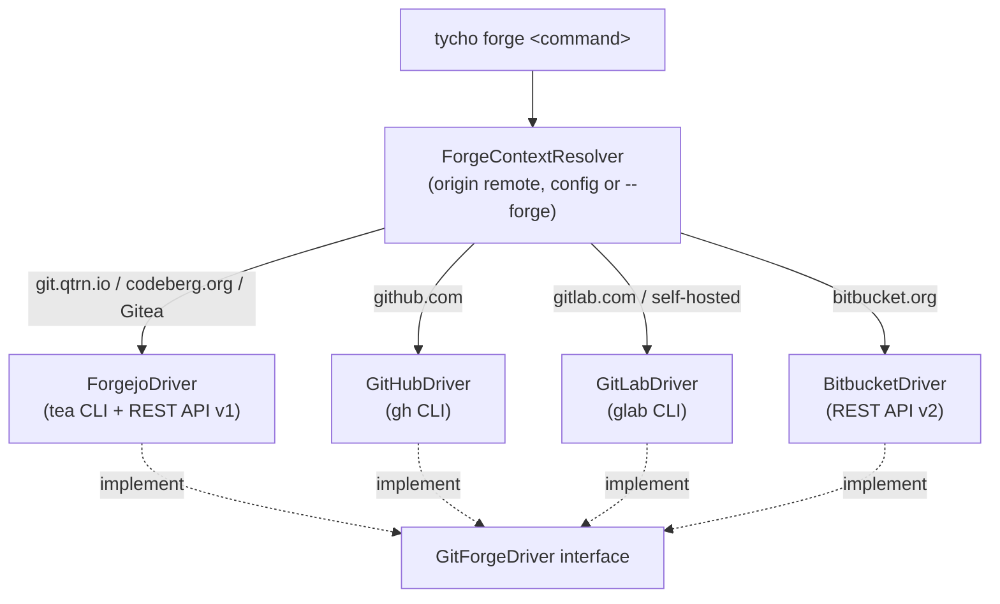

> 🇬🇧 [English version](README.md)

# Tycho Forge

`@tycho/forge` est le module Tycho derrière `tycho forge`. Il offre un vocabulaire unique pour les pull requests, les dépôts, les tickets, les workflows CI et les miroirs sur Forgejo/Gitea, GitHub, GitLab et Bitbucket. La forge est détectée à partir du remote `origin` du dépôt courant ; en l'absence de remote, la forge principale choisie lors de `tycho forge setup` est utilisée. `--forge=forgejo|github|gitlab|bitbucket` force la détection. Pour la vue d'ensemble, voir le [README du cœur Tycho](https://git.qtrn.io/tycho/tycho).



## Installation

```bash
tycho module add forge
```

Les drivers GitHub et GitLab s'appuient sur les CLI `gh` et `glab` ; le driver Forgejo utilise `tea` s'il est présent, sinon l'API REST avec un jeton (`FORGEJO_TOKEN` ou `tycho forge setup`). Bitbucket utilise `BITBUCKET_APP_PASSWORD`.

## Utilisation

```bash
tycho forge setup                                  # choisir la forge principale (aussi : config)
tycho forge pr list [--state=open|closed|all]      # lister les pull/merge requests (alias : mr)
tycho forge pr view <number>
tycho forge pr create --title <t> [--body <b>] [--base <branch>]
tycho forge pr checkout <number>
tycho forge pr merge <number> [--squash|--rebase|--merge]
tycho forge repo view
tycho forge repo clone <target> [destination]
tycho forge repo create <name> [--public] [--org <org>] [--push] [--gitflow]
tycho forge issue list [--state open|closed|all]   # Forgejo uniquement pour l'instant
tycho forge issue create --title <t> [--body <md>] [--label a,b] [--milestone <title>]
tycho forge issue import <roadmap.json> [--dry-run]
tycho forge action list                            # modèles de workflows (alias : workflow)
tycho forge action add container-build             # générer un workflow de build OCI
tycho forge auth status
tycho forge whoami
tycho forge mirror status                          # afficher les remotes configurés
tycho forge mirror sync [remote]                   # pousser branches et tags (remote par défaut : github)
tycho forge status                                 # les commandes git standard sont passées à git
```

Toute autre commande est transmise à la CLI native de la forge (ou à `git`).

## Statut

Fonctionnel. Les commandes de tickets (`issue list|create|import`) ne sont implémentées que par le driver Forgejo ; les autres drivers indiquent qu'elles ne sont pas encore prises en charge.

## Licence

AGPL-3.0-only, © Quatrain Technologies. Source : https://git.qtrn.io/tycho/tycho-forge
