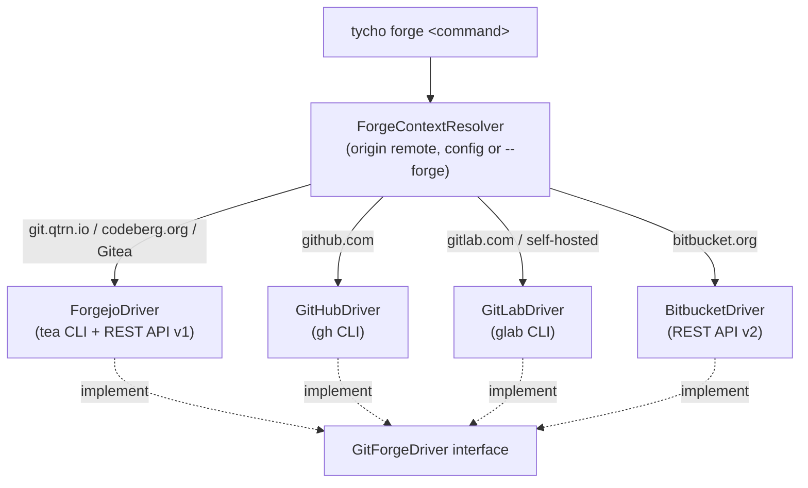

> 🇫🇷 [Version française](README.fr.md)

# Tycho Forge

`@tycho/forge` is the Tycho module behind `tycho forge`. It gives one vocabulary for pull requests, repositories, issues, CI workflows and mirrors across Forgejo/Gitea, GitHub, GitLab and Bitbucket. The forge is detected from the `origin` remote of the current repository; when there is no remote, the primary forge chosen during `tycho forge setup` is used. `--forge=forgejo|github|gitlab|bitbucket` overrides the detection. For the overall picture, see the [Tycho core README](https://git.qtrn.io/tycho/tycho).



## Install

```bash
tycho module add forge
```

The GitHub and GitLab drivers rely on the `gh` and `glab` CLIs; the Forgejo driver uses `tea` when present, otherwise the REST API with a token (`FORGEJO_TOKEN` or `tycho forge setup`). Bitbucket uses `BITBUCKET_APP_PASSWORD`.

## Usage

```bash
tycho forge setup                                  # choose the primary forge (also: config)
tycho forge pr list [--state=open|closed|all]      # list pull/merge requests (alias: mr)
tycho forge pr view <number>
tycho forge pr create --title <t> [--body <b>] [--base <branch>]
tycho forge pr checkout <number>
tycho forge pr merge <number> [--squash|--rebase|--merge]
tycho forge repo view
tycho forge repo clone <target> [destination]
tycho forge repo create <name> [--public] [--org <org>] [--push] [--gitflow]
tycho forge issue list [--state open|closed|all]   # Forgejo only for now
tycho forge issue create --title <t> [--body <md>] [--label a,b] [--milestone <title>]
tycho forge issue import <roadmap.json> [--dry-run]
tycho forge action list                            # workflow templates (alias: workflow)
tycho forge action add container-build             # generate an OCI build workflow
tycho forge auth status
tycho forge whoami
tycho forge mirror status                          # show configured remotes
tycho forge mirror sync [remote]                   # push branches and tags (default remote: github)
tycho forge status                                 # standard git commands are passed to git
```

Any other command is passed through to the forge's native CLI (or to `git`).

## Status

Functional. Issue commands (`issue list|create|import`) are implemented by the Forgejo driver only; other drivers report that they are not supported yet.

## Licence

AGPL-3.0-only, © Quatrain Technologies. Source: https://git.qtrn.io/tycho/tycho-forge
